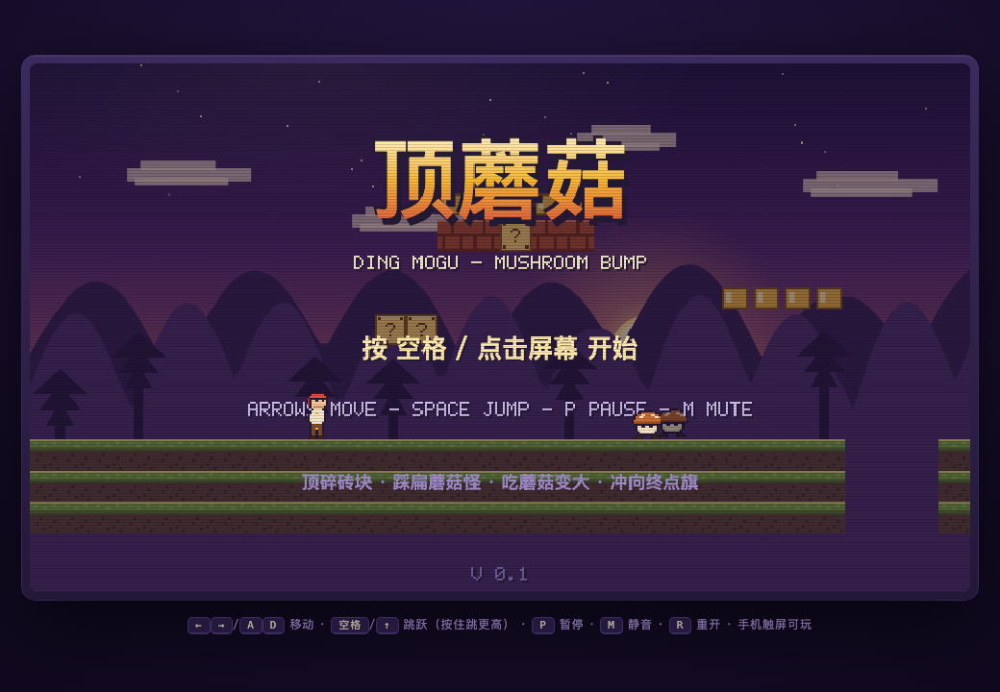
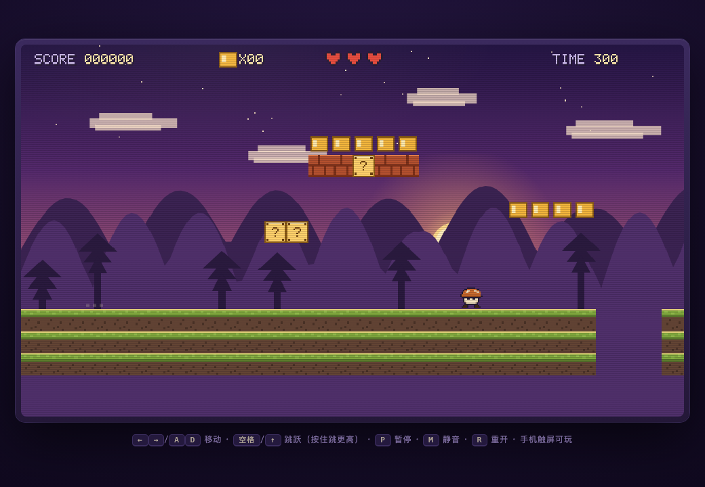
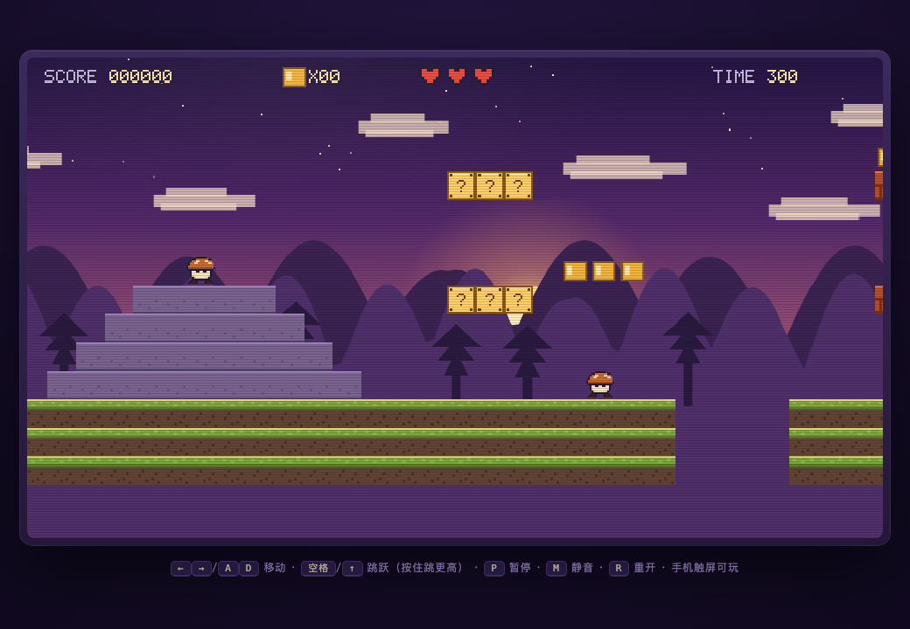
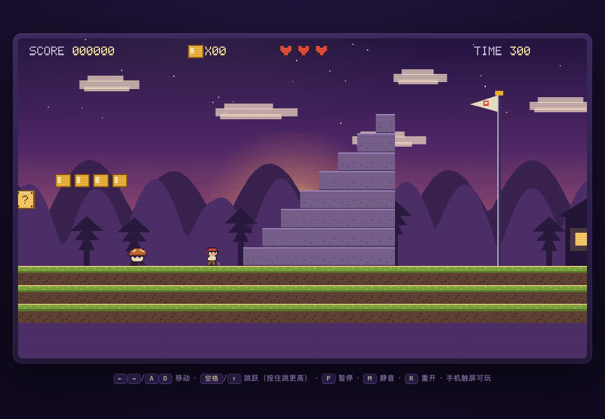

<div align="center">

# 顶蘑菇 · DING MOGU

**44KB 单文件像素街机平台跳跃 · 零依赖 · 零资源文件 · 打开即玩**

[](LICENSE)
[](index.html)
[]()
[]()

🎮 **[在线试玩（GitHub Pages）](https://ming-h.github.io/dingmogu/)** 🎮

黄昏时分的堡垒，一颗会跳的心。顶碎砖块、踩扁蘑菇怪、吃蘑菇变大，冲向终点旗。

</div>

---

| 标题画面 | 开局动线 |
|---|---|
|  |  |

| 平台跳跃段 | 终点：阶梯 · 旗 · 小屋 |
|---|---|
|  |  |

## ✨ 特性

- **真·单文件**：整个游戏是 1 个 HTML（44KB），没有外部请求、没有资源文件夹、没有构建步骤——下载后双击就能玩，扔到任何静态托管上就是一个链接
- **零资源美术**：主角、蘑菇怪、砖块、HUD 全部由代码绘制（字符画像素工厂 + 程序化贴图），连字体都是手写的 5×7 位图字体
- **零资源音频**：跳跃、金币、踩怪等 13 种音效与 8 小节芯片 BGM 全部由 WebAudio 振荡器实时合成
- **街机手感**：土狼时间、跳跃缓冲、按住跳更高、跑动惯性/急停扬尘、镜头前视、受击屏震
- **完整闭环**：214 格手工关卡、变大/变小、连踩分数翻倍（100→1600）、终点旗时间奖励、烟花结算、最高分本地持久化
- **移动端可玩**：检测触屏自动出现虚拟按键；桌面端键盘全操作

## 🎮 操作

| 操作 | 键盘 | 触屏 |
|---|:---:|:---:|
| 移动 | `←` `→` / `A` `D` | ◀ ▶ |
| 跳跃（按住跳更高） | `空格` / `↑` / `W` | 右下「跳」 |
| 暂停 / 静音 / 重开 | `P` / `M` / `R` | — |

## 🕹️ 机制

| 机制 | 说明 |
|---|---|
| 顶砖 | 从下顶 `?` 块 → 金币（+200）或魔法蘑菇；**变大后**可顶碎砖块（+50，碎片四溅） |
| 魔法蘑菇 | 青绿色，吃了变大；大个子被撞只变小（短暂无敌闪烁），小个子被撞丢命 |
| 踩怪 | 踩头击杀蘑菇怪；**空中连踩**分数翻倍 100→200→400→800→1600 |
| 连锁 | 顶砖会震死站在砖上的怪、弹起砖上的蘑菇 |
| 关卡 | 214 格黄昏堡垒：坑洞 × 平台跳段 × 双层砖阵 × 阶梯 × 终点旗，中途有暗存档点 |
| 结算 | 到旗越快奖励越高（剩余时间 ×10），破纪录有烟花 + NEW RECORD |

## 📦 快速开始

**方式一：在线玩**
点上方在线试玩链接，或访问 `https://ming-h.github.io/dingmogu/`。

**方式二：本地玩**
```bash
git clone https://github.com/Ming-H/dingmogu.git
open dingmogu/index.html   # 双击 index.html 也一样
```

**方式三：嵌入你的网页**
```html
<iframe src="https://ming-h.github.io/dingmogu/" width="960" height="620"
        style="border:0;border-radius:12px"></iframe>
```

## 🛠️ 技术架构

```
index.html（约 1100 行，全内联）
├─ CSS        街机外框 / CRT 扫描线 / 触屏按钮（约 60 行）
├─ 像素字体   5×7 位图字形表 + 渲染器（HUD 与拉丁文字）
├─ 精灵工厂   字符画 + 调色板 → 离屏 Canvas（主角小/大 ×4 帧、蘑菇怪、道具…）
├─ 贴图工厂   程序化绘制 7 种砖块（草地/砖/?块/已用/石板/石块）
├─ 音频引擎   WebAudio 振荡器合成 13 种音效 + 8 小节双轨芯片 BGM
├─ 关卡 DSL   buildLevel()：一行字符串就是一段地形
├─ 物理引擎   格子 AABB、X/Y 分步碰撞、变重力跳跃（按住上升段重力更小）
├─ 游戏循环   固定 60 步/秒 + 累加器，渲染插值相机
└─ 状态机     标题 / 游玩 / 变身 / 死亡 / 暂停 / 滑旗结算 / 通关 / 结束
```

**为什么不引 three.js / Phaser？** 2D 像素游戏用原生 Canvas 就是最高效的路径——换来的是 44KB 对 700KB+ 的体积差，和"发一个文件等于发整个游戏"的分发能力。

### 关卡即代码

关卡用一组语义函数描述，可读性与可改性都远高于数组地图：

```js
groundSeg(0,25);            // 铺 0~25 列地面
rowB(11,8,'CC');            // 第 11 列、第 8 行放两个金币 ? 块
rowB(13,5,'BBCBB');         // 五连砖（B砖 C金币块）
coins(13,4,5);              // 砖顶摆 5 枚金币
stairUp(190,8);             // 8 级终点大阶梯
mob(38);                    // 放一只蘑菇怪
```

### 调手感

全部集中在 `index.html` 顶部的 `CFG`：

| 参数 | 默认 | 含义 |
|---|---|---|
| `JUMP` | -8.1 | 起跳初速（满跳 ≈ 4.4 格，可登上 4 格高台；点跳 ≈ 2.4 格） |
| `GRAV_HOLD` | 0.235 | 按住跳跃键上升段的重力（越小跳得越高越飘） |
| `ACC / FRIC / MAXV` | 0.34 / 0.84 / 3.5 | 加速 / 摩擦 / 极速（跑动手感） |
| `WALKER_V` | 0.65 | 蘑菇怪速度 |

## 🔍 开发验证

小项目也配了回归手段，每次改关卡/物理跑一遍：

1. **可达性审计**：从源码提取关卡数据，用引擎同款跳跃物理逐格验算——每枚金币可吃、每块砖可顶、每个高位平台可登（v0.1.1 修复的 5 处不可达金币与"4 格台跳不上"就是它抓出来的）
2. **headless 冒烟**：stub 掉 DOM/Canvas，模拟按键驱动主循环 9900 帧（开始→跑图→暂停→重开），零异常
3. **截图目检**：headless Chrome 对标题/开局/中段/终点四机位截图核对渲染

## 📜 改动日志

- **v0.1.1**（2026-11-11）：可达性修复——跳跃高度 3.86→4.36 格，4 格高台从"只能顶"变为"能跳上"；整改 5 处不可达金币；新增开局"顶→登→收"教学动线；引入可达性审计
- **v0.1**（2026-11-11）：首版发布

## 🗓️ Roadmap

- [ ] v0.2：第二关 + 飞行怪 + 1UP 蘑菇
- [ ] v0.3：本地速通计时榜
- [ ] 远期：玩法验证成熟后移植 Godot 做 Steam 版

## ⚖️ 许可与原创声明

[MIT](LICENSE)。

游戏名"顶蘑菇"指向的是"从下方顶砖出蘑菇"这一经典平台跳跃**玩法机制**；本项目的全部美术（角色、怪物、砖块、UI）、关卡数据、音乐均为原创，不包含任何第三方 IP 素材。

<div align="center">

**给个 ⭐ 如果它让你想起了某个放学的傍晚**

</div>
